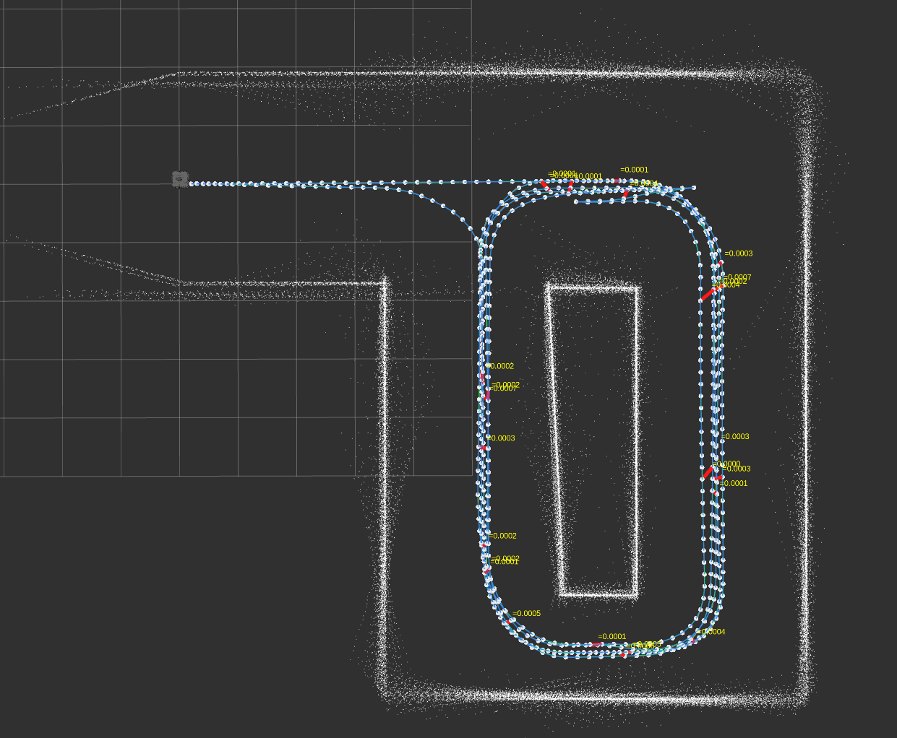
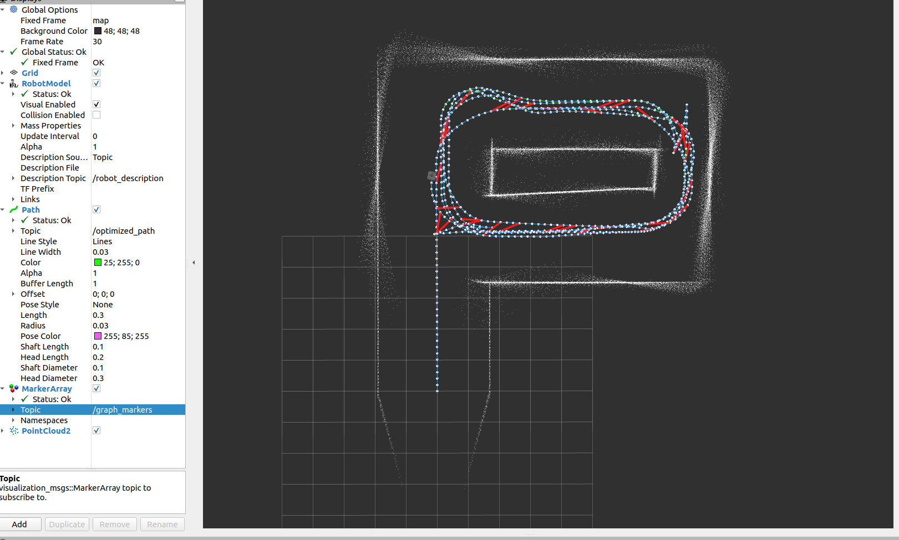
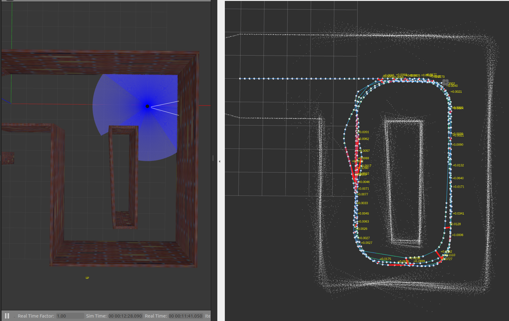

# Pose Graph SLAM — Built from Scratch in ROS 2

A 2D LiDAR Pose Graph SLAM system built from scratch in C++/ROS 2, implemented on TurtleBot3 Waffle in Gazebo simulation. The back-end optimisation approach is based on [Cyrill Stachniss's SLAM lectures](https://www.youtube.com/watch?v=uHbRKvD8TWg).

> **Demo results:** chi² reduced **99.94%** (11,404 → 6.79) in 7 Gauss-Newton iterations across 668 nodes with 24 loop closures.

---

## Demo

### Point Cloud Maps

| | |
|---|---|
|  |  |



### Full Run Video

https://github.com/VyomVyas25/Pose_Graph_SLAM/blob/main/src/media/PGS_rec.mp4

---

## What it does

Pose Graph SLAM builds a map by maintaining a graph of robot poses connected by constraints. Every time the robot moves, an odometry edge is added. When the robot revisits a place it has been before, a loop closure edge is added using ICP scan matching. A Gauss-Newton optimiser then corrects all poses simultaneously to satisfy all constraints as well as possible — snapping the map into alignment.

The system has three components:

- **GraphBuilderNode** — front-end: creates pose nodes, odometry edges, and loop closure edges from `/odom` and `/scan`
- **BackendOptimizer** — back-end: Gauss-Newton sparse optimiser, produces corrected `/optimized_path`
- **PointCloudMapNode** — map builder: reprojects all stored LiDAR scans using corrected poses, publishes `/point_cloud_map`

---

## Prerequisites

| Requirement | Version |
|---|---|
| Ubuntu | 22.04 LTS |
| ROS 2 | Humble Hawksbill — [install guide](https://docs.ros.org/en/humble/Installation.html) |
| TurtleBot3 | `sudo apt install ros-humble-turtlebot3*` |
| Eigen3 | `sudo apt install libeigen3-dev` |
| Gazebo Classic | Installed automatically with TurtleBot3 |

---

## Installation

### 1. Clone

```bash
mkdir -p ~/pgs_ws/src
cd ~/pgs_ws/src
git clone https://github.com/VyomVyas25/Pose_Graph_SLAM.git .
```

### 2. Set TurtleBot3 model

```bash
echo "export TURTLEBOT3_MODEL=waffle" >> ~/.bashrc
source ~/.bashrc
```

### 3. Build

```bash
cd ~/pgs_ws
colcon build --packages-select slam_msgs my_pose_graph_slam
source install/setup.bash
```

Add `source ~/pgs_ws/install/setup.bash` to your `~/.bashrc` to avoid sourcing every time.

---

## Running

Three terminals are needed. Gazebo and teleop are kept separate so you can swap worlds or use a real robot.

### Terminal 1 — Gazebo

```bash
export TURTLEBOT3_MODEL=waffle
ros2 launch turtlebot3_gazebo turtlebot3_house.launch.py
```

### Terminal 2 — SLAM stack

```bash
ros2 launch my_pose_graph_slam slam.launch.py noise:=true
```

This starts the TF bridge, graph builder, backend optimiser, point cloud map node, and RViz all at once.

### Terminal 3 — Drive the robot

```bash
export TURTLEBOT3_MODEL=waffle
ros2 run turtlebot3_teleop teleop_keyboard
```

Drive **3–5 complete laps** to generate enough loop closures for visible drift correction.

---

## Launch arguments

| Argument | Default | Description |
|---|---|---|
| `noise` | `false` | Add artificial odometry drift to demonstrate loop closure correction |
| `lc_cooldown` | `5` | Minimum nodes between accepted loop closures |
| `noise_alpha1` | `0.02` | Translation noise magnitude |
| `noise_alpha3` | `0.005` | Rotation noise magnitude (keep low — high values cause ICP to fail) |
| `scan_skip` | `3` | Publish every N-th scan in the point cloud (higher = faster, fewer points) |
| `rviz` | `true` | Launch RViz2 |

---

## RViz displays

Set **Fixed Frame** to `map`, then add:

| Display | Topic |
|---|---|
| MarkerArray | `/graph_markers` — nodes (white), odom edges (blue), loop closure edges (red) |
| Path | `/optimized_path` |
| PointCloud2 | `/point_cloud_map` |

---

## Troubleshooting

**No loop closures after lap 2:**
```bash
ros2 launch my_pose_graph_slam slam.launch.py noise:=true lc_cooldown:=5
```

**Optimizer shows Δx ≈ 0 with `noise:=false`:**
Expected — Gazebo odometry is near-perfect with no drift to correct. Use `noise:=true`.

**Graph explodes (nodes fly off track):**
Rotation noise is too high. Reduce `noise_alpha3`:
```bash
ros2 launch my_pose_graph_slam slam.launch.py noise:=true noise_alpha3:=0.003
```

**`slam_msgs` not found:**
```bash
colcon build --packages-select slam_msgs
source install/setup.bash
colcon build --packages-select my_pose_graph_slam
```

---

## Acknowledgements

- [Cyrill Stachniss](https://www.youtube.com/watch?v=uHbRKvD8TWg) — SLAM lecture series this back-end is based on
- [Eigen](https://eigen.tuxfamily.org/) — sparse linear algebra
- [ROS 2 Humble](https://docs.ros.org/en/humble/) — middleware
- [TurtleBot3](https://emanual.robotis.com/docs/en/platform/turtlebot3/overview/) — robot platform
